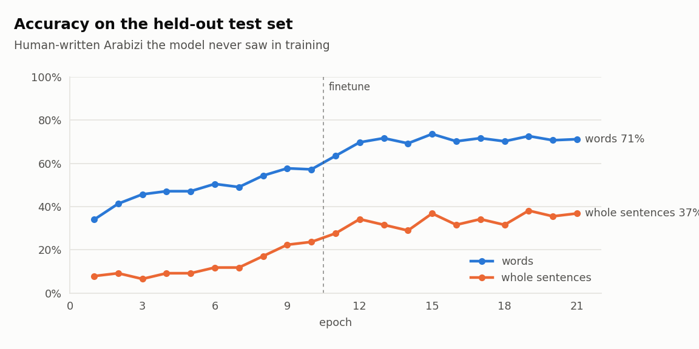
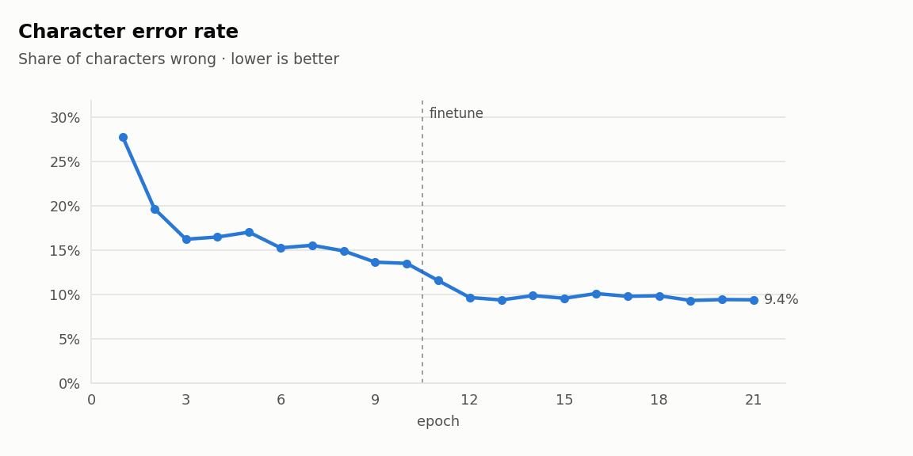
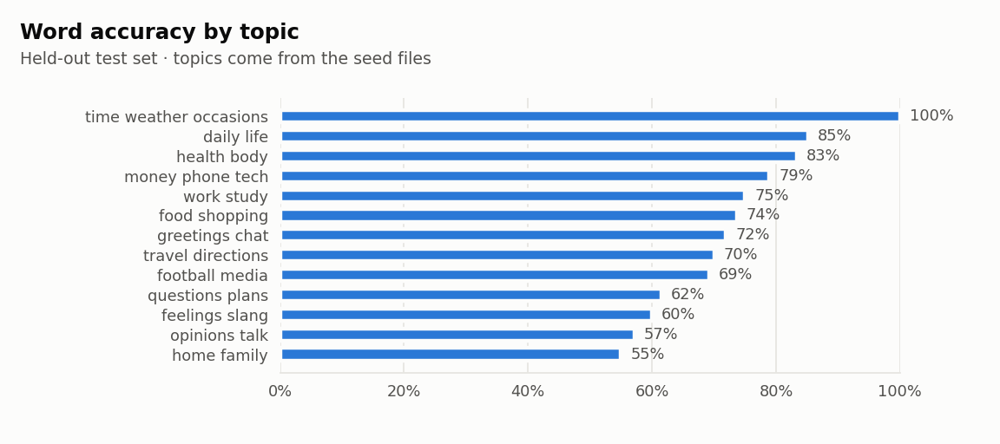
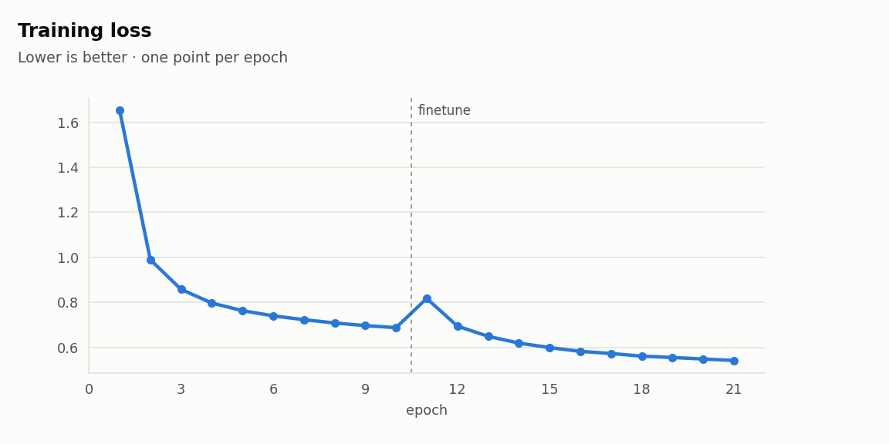
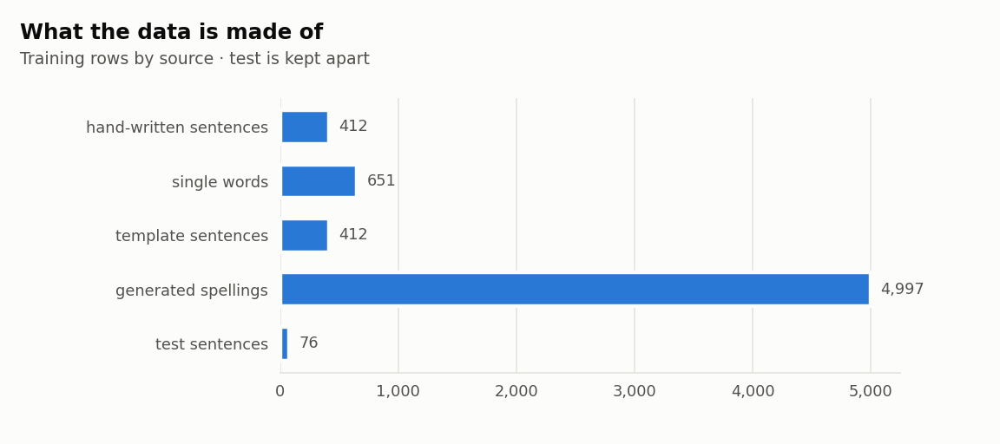
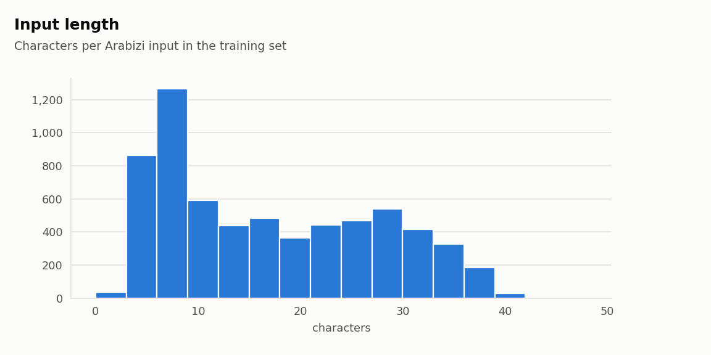

# egyptian-arabizi-franco

Egyptian **Arabizi → Arabic**, offline and lightweight: `3amel eh` → `عامل ايه`.

A tiny character-level transformer (about 3M parameters) that runs on a CPU in milliseconds. It handles the
way people really type: number letters (3, 7, 2, 5), doubled letters, missing vowels, mixed English
(`el meeting bokra` → `الmeeting بكرة`) and stretched words (`awyyy`).

> **Status: early, but working.** First model trained; next step is better pre-training data.

## Results

Scored on 76 hand-written test sentences the model never saw in training:

| Model | Words right | Whole sentences right | Character errors |
|---|---|---|---|
| Hand-written data only | 15% | 1% | 58% |
| Pre-trained on Egyptian Wikipedia | 57.7% | 23.7% | 13.5% |
| **Pre-trained + fine-tuned (current)** | **73.6%** | **36.8%** | **9.6%** |

| Arabizi | Model output | |
|---|---|---|
| ezayak 3amel eh | ازايك عامل ايه | almost (ازيك) |
| eh el a5bar | ايه الاخبار | ✓ |
| mabrook ya 7abibi | مبروك يا حبيبي | ✓ |
| ramadan kareem | رمضان كريم | ✓ |
| el3afw | العفو | ✓ |
| msh fahem 2asdak | مش فهم قصدك | long vowel missed (فاهم) |

Most remaining mistakes are long vowels (فاهم → فهم, حالا → حلان), which the synthetic pre-training data spells
by guesswork. The full run, epoch by epoch, is in [train_colab.ipynb](train_colab.ipynb). The test set is small,
so scores move a few points between epochs.

Charts from that run (the line after "finetune" is where fine-tuning starts):









## The data

<picture>
  <source media="(prefers-color-scheme: dark)" srcset="docs/charts/dataset-dark.png">
  
</picture>

- **Hand-written pairs** in `data/seed/`, one file per topic (greetings, daily life, food, work and study,
  feelings and slang, football and media, questions and plans). About 15% of them are held out as the test set.
- **Template sentences** (`tools/templates.py`): patterns with interchangeable parts, each written in both
  scripts, so every generated sentence still comes with a natural spelling.
- **Generated spellings** (`training/variants.py`): each sentence's Arabizi respelled the ways other people
  type it. English words are never changed.
- **Single words and two-word chunks** cut from the hand-written sentences, so the model learns the letter
  mapping and doesn't just recall whole sentences.
- All Arabic targets follow one spelling standard: [STYLE.md](STYLE.md).

### Pre-training

Before it sees the hand-written data, the model is pre-trained on a large synthetic set
(`tools/build_pretrain.py`): short chunks of Egyptian Arabic from the
[Egyptian Arabic Wikipedia](https://arz.wikipedia.org) (the `20231101.arz` snapshot of
[wikimedia/wikipedia](https://huggingface.co/datasets/wikimedia/wikipedia), CC BY-SA 4.0), written in Arabizi by
`training/variants.py`. The text is downloaded when you build the set and is not part of this repo.
With only hand-written data the first model got 15% of words right on the test set, guessing Arabic-looking
words instead of converting letters; pre-training on a few hundred thousand varied chunks is what fixes that.

<picture>
  <source media="(prefers-color-scheme: dark)" srcset="docs/charts/lengths-dark.png">
  
</picture>

## Try it

Open [infer_colab.ipynb](https://colab.research.google.com/github/BackendNeuron/egyptian-arabizi-franco/blob/main/infer_colab.ipynb)
in Colab (no GPU needed) and Run all. It loads the model from your Google Drive (or a `.pt` file you upload) and
runs six tests: everyday phrases, one sentence spelled six ways, mixed English, unseen words, the score on the
held-out test set with every miss listed, and CPU speed. The last cell has a box to type your own Arabizi.

## Install and use

### Python

[](https://pypi.org/project/egyptian-arabizi-franco/)

```bash
pip install egyptian-arabizi-franco
```

```python
from egyptian_arabizi_franco import convert

convert("ezayak 3amel eh")                       # 'ازيك عامل ايه' (the model writes ازايك for now)
convert(["eh el a5bar", "3andy el meeting bokra"])  # ['ايه الاخبار', 'عندي الmeeting بكرة']
```

From the command line:

```bash
egyptian-arabizi-franco "ezayak 3amel eh"
cat chat.txt | egyptian-arabizi-franco
```

Works offline on an ordinary CPU (roughly 50–100 ms for a short sentence on a laptop; it varies by machine). Needs only `onnxruntime` and `numpy`; the model
(about 13 MB) comes with the package. More options: [packages/python](packages/python/README.md).

### In a FastAPI backend

```python
from fastapi import FastAPI
from pydantic import BaseModel, Field
from egyptian_arabizi_franco import Converter

app = FastAPI()
converter = Converter()  # load the model once, when the server starts


class ConvertRequest(BaseModel):
    texts: list[str] = Field(max_length=100)  # e.g. {"texts": ["ezayak 3amel eh", "eh el a5bar"]}


@app.post("/convert")
def convert(req: ConvertRequest):  # plain def: FastAPI runs it in a worker thread
    return {"arabic": converter.convert([t[:500] for t in req.texts])}
```

```bash
pip install egyptian-arabizi-franco fastapi uvicorn
uvicorn main:app
curl -X POST localhost:8000/convert -H "Content-Type: application/json" -d '{"texts": ["eh el a5bar"]}'
# {"arabic": ["ايه الاخبار"]}
```

Tips for a backend:

- **Create the `Converter` once**, at module level or at startup. Loading it takes around a second, so doing it on
  every request would add that to each one.
- **Use `def`, not `async def`, for the endpoint.** The conversion is CPU work, so FastAPI should run it in its
  thread pool instead of blocking the event loop. One converter can be used from several threads at once.
- **Send lists when you have several texts.** One call with 50 texts is much faster than 50 calls with one.
- **Limit the input size** (the example allows 100 texts of up to 500 characters) so one huge request can't hog
  the CPU.
- **Speed is a rough guide, not a promise:** in our tests on an ordinary laptop CPU, a short sentence took
  somewhere around 50 to 100 ms on its own, and less per sentence when sent in a batch. Your numbers will depend
  on the machine, the text length and how many requests arrive together, so measure on your own server.

### What the package does around the model

- English work and tech words stay in Latin letters: `el meeting` → `الmeeting`, `el password` → `الpassword`
- numbers, punctuation and emojis pass through unchanged
- stretched letters are shortened first: `awyyyy` → `awy`
- long text is converted in runs of up to six words

With these rules, the current package (0.1.1; same model as 0.1.0) gets **75.0% of words and 40.8% of whole sentences** right on the test set
(the model alone: 73.6% / 36.8%).

## Train it

On Colab (free T4 GPU, minutes): open [train_colab.ipynb](train_colab.ipynb) and Run all. Checkpoints are
saved to Google Drive, so a cut-off session resumes where it stopped.

Locally (CPU works, just slower):

```bash
pip install -r requirements.txt
python tools/build_dataset.py
python train.py --new
python tools/plots.py --model runs/best.pt
```

Continue training later on new data, without starting over:

```bash
python tools/build_dataset.py
python train.py --continue-from runs/best.pt --epochs 20
```

The character set is fixed in `training/charset.py`, so a saved model can always continue training.


## Roadmap

- [x] spelling standard, hand-written seed data, spelling-variant generator, templates
- [x] trainer with new / resume / continue modes, Colab notebook, charts
- [x] pre-training on synthetic data from the Egyptian Arabic Wikipedia
- [x] first trained model: 73.6% words, 36.8% whole sentences on the test set
- [ ] realistic AI-written Arabizi for pre-training (proper vowels), longer pre-training
- [ ] snap outputs to real words from a word list (fixes near-misses like حلان → حالا)
- [ ] more hand-written data (target 3–5k) and a bigger test set (~200 sentences)
- [ ] training charts in this README (pushed from Colab after each run)
- [x] ONNX export (`tools/export_onnx.py`, checked against the original model) and the Python package
- [x] published on PyPI: `pip install egyptian-arabizi-franco` (0.1.0, then 0.1.1 with the FastAPI guide; see [CHANGELOG.md](CHANGELOG.md))
- [ ] live demo page and browser extension

## Licence

MIT. Data in `data/seed/` was written for this project. Pre-training text: Egyptian Arabic Wikipedia
contributors, CC BY-SA 4.0.
